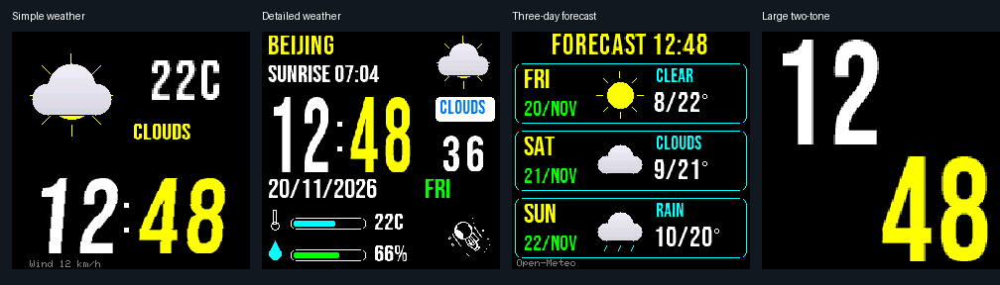

# GeekMagic 对比与 NM-TV-154 优化设计草案

日期：2026-11-20。状态：用户已补充四张参考屏幕照片，并要求按图更新、使用 Open-Meteo。实施范围见下方更新。

## 用户参考图更新

按用户照片实现四种布局：简洁天气时钟（图标、温度、状况、白色小时与黄色分钟）、详细天气时钟（城市、日出、大时间、秒、日期、温湿度及装饰图案）、三日天气预报（日期、WMO 图标、每日最低/最高温），以及左上白色小时和右下黄色分钟的大字时钟。原草案中的指针表盘不纳入本轮。

四种布局放在现有 Weather 模式下，直接绘制并共享天气缓存，避免占用紧张的 LittleFS 和主题安装数量。现有 Classic 24/12 和自定义 `.stheme` 仍可用。提供布局选择与自动轮换。Open-Meteo 一次获取实时天气及三日预报，采用显式 Celsius/km/h、地点本地日期，设备时钟继续使用已配置时区。网络或解析失败保留缓存并提示；无天气时仍显示时间。

本轮同时接通现有相册上传与管理列表。浏览器照片转换保持为后续阶段，当前明确接受 `.stheme`，不将 GIF 首帧当作完整动画。

## 本轮实现与验证结果

四种原生布局已实现，可在 Weather 页直接选择，或按 10–3600 秒间隔自动轮换，默认 20 秒。回到天气页会重新开始当前布局的停留计时，切换不写 Flash；此行为替代初稿中的自定义主题轮播方案。简洁页保留可选单位的风速信息，详细页仅对秒数区域局部刷新。当前设备屏幕文字使用 ASCII，中文城市名显示为 Weather。预览来自实际 C++ 绘图命令和同款 5×7 位图字体，使用固定示例天气，不是设备实拍：

Open-Meteo 使用 HTTPS、HTTP/1.0、最多 4096 字节响应、显式 Celsius/km/h、地点时区和三日预报。仅在整份响应验证成功后替换缓存；失败保留上次成功值并显示红点。极地无日出时显示 `--:--`。免费入口无需 API Key，适用于非商业使用；商业部署需采用合适的 Open-Meteo 服务计划。时钟时区由设备配置决定，预报日期和日出由地点决定，用户应配置一致。

相册列表与时钟列表分组，支持安装、显示、删除和刷新；相册上传通过服务端验证图片 ID 后才发布，避免把时钟包装入相册。无文件、坏包、失败请求、删除取消、列表刷新失败和按钮恢复均有回归覆盖。JPG/GIF 直接导入仍属于后续阶段。

验证结果（2026-11-20）：

- Open-Meteo 解析测试通过；覆盖零值、负温度、三日预报、空字段、日期校验和失败后缓存保留。
- 绘图边界/状态测试通过；覆盖四种布局、00:00/12:00/23:59、雨雪雾雷和夜间图标、长地点、极端正负温度、C/F 与加载失败占位。预览已检查。
- 设置测试 67 项检查、0 失败，天气单位测试通过；weather/theme/mode/auth/update/sun 下的 16 个 Node.js 测试脚本均通过。
- 独立审查发现并修复触摸手动进入天气页时 SNTP 未启动的问题；执行实际 `clockReapply()` 的回归测试在旧条件下失败，修复后通过，并确认重复进入不重复启动 SNTP、时区/NTP 服务变更可重新配置。
- `gzip_webui.py --check` 通过；工厂资源测试 2 项通过，两种固件及含 LittleFS 的工厂镜像生成成功。

| 固件 | OTA 文件大小 | OTA 槽 | 剩余空间 |
| --- | ---: | ---: | ---: |
| smalltv_esp32 | 1,886,368 B | 1,966,080 B | 79,712 B |
| smalltv_esp32_wg | 1,931,936 B | 1,966,080 B | 34,144 B |

两者通过 8192 B 最低余量检查。LittleFS 镜像为 196,608 B，包含原有 12 个工厂包，四种新增时钟不增加相册文件占用。实际联网、触摸观感、连续轮播及通知覆盖恢复仍待 NM-TV-154 实机验证；本轮未刷机。

本机验证使用项目缓存中的 PlatformIO/pioarduino 6.1.19 与 SCons 4.8.1。系统默认 6.2.0.post1 会触发项目 CI 已记录的 `SCons.Tool.FortranCommon` 故障。C++ 主机测试使用 WSL g++；Windows 主机编译器缺少运行库，未使用其结果作为通过依据。

## 1. 调研依据

本次只读查看 `http://192.168.124.19/` 的 Settings、Pictures、Time 页面，以及版本、相册配置、文件列表和存储接口。设置页与 `/v.json` 均确认参考设备为 SmallTV-Ultra、Ultra-V9.0.54。未保存配置、上传或删除文件、切换主题、重启设备。

参考设备列出七种模式：Weather Clock Today、Weather Forecast、Photo Album、Time Style 1/2/3、Simple Weather Clock。未获得三个 Time Style 的设备屏幕截图，因此本方案借鉴功能和组织方式，不声称逐像素复刻外观。

工程已有较多未提交修改，本次对比以当前工作区为准。旧文档 `smalltv-ultra-webui-nm-tv-154.md` 记录的是 `.31` 及较早状态，其中部分“尚未实现”的功能已存在，保留该历史文档。

## 2. 功能对比

| 功能 | GeekMagic 实机 | 当前工程 | 优化结论 |
| --- | --- | --- | --- |
| 独立相册模式 | Photo Album | 已有 Pictures、应用 Carousel、定时应用入口 | 保留并补齐管理流程 |
| 导入 | JPG/GIF；网页有 JPG 正方形裁剪和旋转 | 只接收 `.stheme`，JPG/GIF 要用电脑工具转换 | 浏览器预处理照片，设备复用主题渲染 |
| 文件管理 | 名称、大小、查看、Delete、Set、Reload、Clear、剩余空间 | 有表格与上传按钮，但没有表格填充逻辑和 `installPicture()` | 优先接通安装、列表、显示、删除、刷新 |
| 相册播放 | 当前 `/album.json` 返回自动播放开启、间隔 5 秒 | 已有 `pictureAuto`、2–3600 秒间隔和运行态轮播 | 不重复实现，补充空列表和坏包反馈 |
| 资源 | 10 个 JPG/GIF | 已内置这 10 个素材的转换包 | 不重复导入 |
| 画质和动画 | 原始 JPG/GIF | 工厂版本为 240×240、3 色，GIF 每个只抽 2 帧、4 FPS | 明确标为精简资源，不能称为原动画保真 |
| 时钟种类 | Time Style 1/2/3，另有天气时钟 | 工厂只有 Classic 24、Classic 12 | 新增三种差异明显的轻量时钟 |
| 时钟选择 | 点按钮直接选用 | 下拉框混有图片包 | 时钟和相册分组，主题卡片直接选用 |
| 主题轮播 | 勾选多个主题，设置秒级间隔 | 有应用轮播，没有多个时钟包的独立轮播 | 新增时钟内部轮播 |
| 12/24 小时、日期、颜色 | 网页单独设置，时/分/秒可分别着色 | 主题 token、分层颜色已支持 | 通过预设复用，不新增平行时钟系统 |
| 冒号闪烁 | 有开关 | 没有找到通用主题属性 | 后续单独扩展并验证 |
| 自定义 NTP | 支持 | 已实现自定义服务器和内置兜底 | 无需重复实现 |
| 天气单位 | 温度、风速、气压 | 温度和风速已实现，没有气压字段 | 本轮聚焦相册与时钟 |
| 夜间模式 | 定时降低亮度 | 已有夜间模式 | 复用 |

相册管理缺口已复现：将页面主题脚本加载到 Node VM 后，`installTheme`、`selectPicture` 均为函数，`installPicture` 为 `undefined`；`pictureList` 在整页仅出现一次，即表格声明。现有 `node tests/theme/test_webui_pictures.js` 通过，但未覆盖这两个入口。

## 3. 资源约束

- NM-TV-154 为经典 ESP32，4 MB Flash、240×240 屏幕。
- 当前分区有两个 0x1E0000 字节 OTA 槽，每槽 1,966,080 字节；LittleFS 为 192 KiB。
- 工厂共 12 个包：2 个时钟、10 个图片/动画，包载荷 141,460 字节。这不是文件系统已用量，仍有 LittleFS 元数据及配置开销。
- 安装上限是 16 个包，时钟与相册共用。预装三个新时钟后为 15 个，导入照片可能需要先删除其他包，必须明确提示。
- 现有资源测试要求工厂载荷不超过 147,456 字节，给原始分区保留至少 48 KiB 预算。因此三个新增时钟合计预算为 5,996 字节，最终须以 LittleFS 实际打包结果验收。
- 上传接口保留不少于 16 KiB，或“配置文件大小 + 4 KiB”二者较大值。网页预估必须与服务端规则一致，由服务端最终判断。
- 已有全功能固件产物长 1,916,288 字节，距槽大小为 49,792 字节。这是已有产物信息，并非本次重新构建验证。

## 4. 路线选择

| 路线 | 收益与代价 | 建议 |
| --- | --- | --- |
| A. 相册管理 + 浏览器照片转换 + 多时钟 | 用户直接选照片，设备复用现有格式；需增加网页转换与预览 | 推荐，分阶段完成 |
| B. 相册管理 + 多时钟，保留电脑转换 | 改动少、先让现有入口可用；导入照片仍需额外工具 | 可作为第一阶段或保守范围 |
| C. 设备原生解码 JPG/GIF | 格式接近参考设备；增加固件和 RAM 压力，192 KiB 文件区仍有限 | 当前硬件不优先采用 |

## 5. 推荐设计

### 第一阶段：相册管理与多时钟

相册管理实现 `installPicture()` 并复用 `/api/themes/install`。保留现有鉴权、流式接收、包验证及原子发布。列表显示名称、实际包大小、有效状态及显示、删除操作，增加刷新入口。上传成功后更新列表并选中新图片，由明确的“显示图片”操作开始播放。

图片判定在前后端一致，兼容 `ultra-*`、`pixel-motion`、`picture-*`。时钟列表排除这些专用图片包，其他已有自定义主题仍可选用。服务端拒绝删除正在显示或参与轮播的有效包时，前端解释如何切换并保留条目；空相册、坏包、空间不足、数量上限、上传失败均有中英文反馈。

新增时钟均以可复现的 `.stheme` 提供，复用已有文本与形状能力，不引入新的字体二进制：

| 预设 | 240×240 设计 | 实现 |
| --- | --- | --- |
| Color Digital | 大号白色小时、黄色分钟，秒和日期独立成行 | 文本层和时间 token |
| Stacked Clock | 上下排列大号小时、分钟，底部星期和日期 | 文本层与几何背景 |
| Analog Dial | 圆形刻度、时针、分针、秒针及日期 | spec 2 ticks/hand、time 绑定 |

保留 Classic 24 和 Classic 12。预览从同一份主题定义生成，以确定时间检查，避免预览与安装包不一致。

时钟内部轮播提供开关、勾选列表、10–3600 秒间隔，最多选择 8 个有效时钟。少于两个有效主题时禁止启用并提示。配置保存默认主题和列表，切换仅更新运行态 ID，不逐次写 Flash。缺失和坏包跳过；只剩一个时停留，全部失效时提示重新选择。删除保护覆盖运行态主题和启用中的轮播列表。

时钟轮播仅在主题实际显示期间计时，离开主题或被通知覆盖时暂停，返回后保留剩余停留时间。应用 Carousel 继续负责天气、相册、时钟等应用间切换，两套状态独立。

### 第二阶段：浏览器照片导入

网页允许 JPG/JPEG/PNG 和已有 `.stheme`。照片在浏览器本地处理：居中裁剪或完整适配、90° 旋转、最终 240×240 预览。按质量档位转换为 STI2，再打包为标准 `picture-*` 主题，设备仍只接收 `.stheme`，不上传原图到第三方服务。

展示转换包实际大小、总包数、剩余空间及安装预算。空间不足时让用户降低色数或移除其他包，不无提示地把照片降成三色。

GIF 首轮继续用现有电脑工具转换后安装。浏览器 GIF 导入须另行验证帧合成、透明度、disposal、帧时长和浏览器兼容性，不能把首帧当作动态 GIF 导入成功。工厂两帧资源明确标为精简动画；完整动画效果按逐个素材的实际容量预算评估。

## 6. 变更位置

- `src/webui.html` 与生成的 `src/webui.h`：管理、安装、提示、时钟卡片、轮播设置；第二阶段加入照片转换。
- `src/features/theme/ThemeMode.h/.cpp`：时钟运行态选择、暂停恢复、轮播，保留相册独立状态。
- `src/features/theme/ThemeWeb.cpp`：复用安装与删除接口，完善轮播占用检查。
- `src/Settings.h/.cpp`：轮播配置及边界校验，兼容缺少新字段的旧设置。
- `tools/build_nm_tv_154_assets.py`、`assets/nm_tv_154/themes`、`data/nm_tv_154/themes`：新时钟与可复现资源记录。
- `tests/theme` 和配置、模式相关测试：覆盖实际操作、轮播、资源预算。

## 7. 验收

1. 安装、列表、显示、删除、刷新可用，按钮无未定义函数错误；测试失败后的 UI 状态。
2. 时钟与专用相册包正确分组，已有自定义时钟仍可用。
3. 覆盖空列表、坏包、容量不足及数量上限；保留配置写入空间。
4. 三种时钟在 00:00、12:00、23:59 生成预览，检查布局及时间 token。
5. 轮播覆盖计时回绕、暂停恢复、无效条目和列表变更，确认每次切换不保存配置。
6. 资源记录与包大小一致，全部工厂包实际装入 192 KiB LittleFS。
7. 构建 `smalltv_esp32_wg` 和 `smalltv_esp32`，记录实际大小并检查 OTA 槽限制。
8. 第二阶段验证照片方向、裁剪、旋转、包校验和容量反馈。
9. 目标 NM-TV-154 实机验收观感、触摸、连续轮播、通知恢复和联网稳定性；源码测试和构建不能代替实机验证。

## 8. 待确认范围

推荐路线 A：先完成第一阶段，再做浏览器照片导入。路线 B 可先交付现有格式的可用相册和多时钟。三个 Time Style 若需视觉复刻，须补充可靠的设备屏幕视觉依据；当前提议为功能借鉴。
