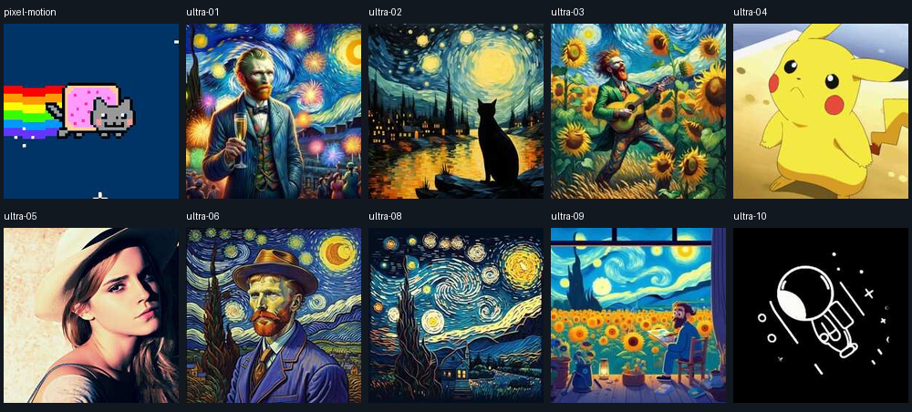
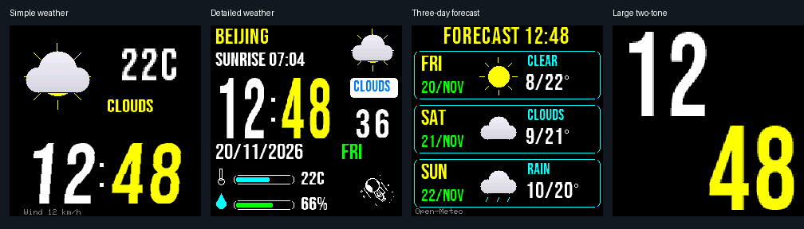

# NM-TV-154 全彩相册、雷达位置与时钟改进

## 本轮变化

- 相册使用 `docs/product/assets/smalltv-ultra/pictures` 中全部 10 个原始文件。原来的 3 色量化导致严重丢色，现保留 RGB 色彩，输出 240×240 baseline JPEG；GIF 仍采样两帧，4 fps 循环。12 个出厂主题包共 137,028 字节，实际 LittleFS 镜像为 196,608 字节，适配原有 192 KiB 分区。
- 经典 ESP32 使用 ROM 自带 TJpgDec，工作区 4 KiB，直接输出图像小块到屏幕，不申请整张 RGB565 帧缓冲。STI1/STI2 主题保留原有渲染路径；JPEG 仅允许 spec 2、单个全屏图片或动画图层，不允许叠加、滚动或绑定。其他芯片明确拒绝 JPEG 包。
- Plane Radar 有独立设置页。Home location 明确为雷达地图中心和飞机查询圆心。可选择天气／设备位置，也可使用独立经纬度；支持离线城市预设、Open-Meteo 城市搜索、六位小数预览以及纬度／经度范围校验。0/0 仍为未设置位置。保留旧配置兼容和分项保存。
- 独立雷达保存不会覆盖天气位置；使用共享位置时会同时保存界面显示的共享坐标。“保存并显示雷达”同步设备模式和网页模式，后续全局保存不会切回旧模式。
- 四种天气时钟采用仓库已包含的 Bebas Neue 字体，增加抗锯齿数字、细长文字、云朵明暗、圆角预报框、白底天气标签、绿色星期、胶囊仪表与倾斜宇航员。字体许可证见 `examples/themes/bebas-clock/fonts/OFL.txt`。天气数据继续使用 Open-Meteo。

## 预览

## 升级方式

输出目录为 `dist/nm-tv-154-refined-20261120`。只适用于经典 ESP32、4 MB flash 的 NM-TV-154，保留前轮 DNS/NTP TCPIP core 崩溃修复。

### 保留配置与自定义图片

1. 通过网页 System 上传 `nm-tv-154-ota.bin`，使用 WireGuard 的设备选 `nm-tv-154-wg-ota.bin`。这一步仅更新程序，不改图片和配置。
2. 在 Pictures 的图片管理中删除旧的 `ultra-*` 和 `pixel-motion` 出厂图片，释放空间；保留自己的 `picture-*` 和需要的时钟主题。
3. 解压 `factory-picture-packages.zip`，通过 Pictures 的 `Install .stheme` 逐个安装其中 10 个新图片包，再选择显示或自动轮换。旧包与新包 ID 相同，必须先移除旧包。若保存了较多自定义包，需为新包腾出空间，或只安装需要的图片。

JPEG 新包必须配合本轮新固件。只上传 OTA 程序不会修复旧图片本身。

### USB 完整安装

先在 System 导出配置并下载需要保留的自定义主题。将 `nm-tv-154-factory.bin` 或 `nm-tv-154-wg-factory.bin` 烧录至 **0x0**。文件已包含 bootloader、分区表、应用与全彩 LittleFS，不要当作 OTA 文件上传。

完整镜像会替换配置和图片，并覆盖相应 NVS 区域；安装后重新配网、导入备份配置。无需额外全片擦除。`nm-tv-154-littlefs.bin` 可在应用已更新、分区表相同的设备上单独烧录至 **0x3d0000**，它也会替换文件系统中的配置和自定义图片。

## 验证与边界

- 全彩图像测试检查所有出厂包为 240×240、超过 256 种实际解码颜色，JPEG 对 RGB 源图的平均通道误差低于 22，并验证包体预算。
- 原生固件解析器验证全部 12 个实际包，并拒绝尺寸错误、非零保留字段、progressive JPEG、缺少结尾以及不支持的复合布局。
- 天气单位、Open-Meteo 解析、四种布局的边界与错误状态、雷达配置边界和旧配置兼容、浏览器保存往返及 DNS/NTP 回归均执行验证。
- 标准版 OTA 1,908,384 字节，槽位余量 57,696；WireGuard 版 OTA 1,953,904 字节，余量 12,176。两者通过 8 KiB 最小余量检查；LittleFS 实际打包成功。
- Windows 工作区为 CRLF，完整主题套件中的 `test_data.cpp` 会在按 LF 精确匹配源码的断言处失败；本地 WSL 也缺少 32 位 C++ 开发头文件，无法编译 `-m32` 内存测试。与本次格式直接相关的包／字体／渲染／目录验证及三个现有主题各五分钟的模拟渲染均单独通过。这些环境限制需与固件行为区分。
- 预览来自实际绘图代码。此次未烧录实机；屏幕颜色、ROM 解码时序和联网稳定性仍需刷机后确认。
