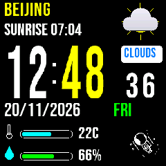

# Detailed weather 开机页、spaceman 动画和 IP 轮换

## 显示效果

此预览压缩了等待时间，以便同时观察 Sunrise/IP 两种状态。设备上每种信息实际显示 10 秒，spaceman 按原 GIF 每帧 80 毫秒循环。

## 行为

- Detailed weather 右下角使用 `docs/product/assets/smalltv-ultra/pictures/spaceman.gif` 的全部 14 帧。将原图按比例缩至 56×56，保留其黑底白色线条，生成内置 RLE 像素数据，不需要设备运行 GIF 解码器或额外安装图片包。动画占据 x=180..235、y=180..235。
- Sunrise 行与 `IP x.x.x.x` 每 10 秒轮换。联网时显示 STA 地址；未连接时若配网热点可用则显示热点地址；没有地址时显示 `IP offline`。网络地址在页面停留期间每秒重新检查，切换不等待整分钟刷新。
- 秒数、动画与信息栏分别局部刷新，气象数据更新或分钟变化时才重画整页。动画更新不会覆盖温湿度、日期或秒数。
- NM-TV-154 标准版和 WireGuard 版正常开机后，均进入 `mode=weather`、`weatherStyle=dashboard`、`weatherAuto=false`。该启动选择在读取既有配置之后应用，因此 OTA 升级设备也生效，不依赖清除配置。
- 启动时不主动写入 flash，天气地点、网络和其他功能设置保留。运行期间仍可从网页或触摸切换页面、开启自动轮播；下一次正常开机重新进入 Detailed weather。异常重启继续保留安全模式策略，ESP8266、C2 和 Pro 板启动行为不变。

## 构建与验证

- 标准版 OTA：1,912,224 字节，槽位余量 53,856 字节。
- WireGuard 版 OTA：1,957,760 字节，槽位余量 8,320 字节。
- 两版构建及 8 KiB 最小 OTA 余量检查通过。WireGuard 版后续增加功能时需持续检查容量。
- 原图逐帧生成一致性、14 帧差异、80ms 边界和 1120ms 循环、Sunrise/IP 的 10 秒边界及最长 IPv4 字符串、所有天气布局的边界、正常与安全模式启动以及其他目标宏分支均通过测试；独立代码复核未发现阻塞问题。
- 本地原生 C++ 测试使用 WSL；Pillow 原图验证使用 Windows Python。尚未烧录设备，实际播放流畅度和联网效果待上机确认。

## 升级

`dist/nm-tv-154-dashboard-20261120` 提供本轮两版 OTA 程序和对应 ELF。网页 System 中上传对应的 `*-ota.bin` 即可，保留现有文件系统与配置。此次 spaceman 动画无需更新 LittleFS。

若设备仍保留早期的 3 色全屏相册，继续按上一轮全彩相册说明更换出厂图片包；本轮内置 spaceman 不会自动替换那些独立相册文件。
