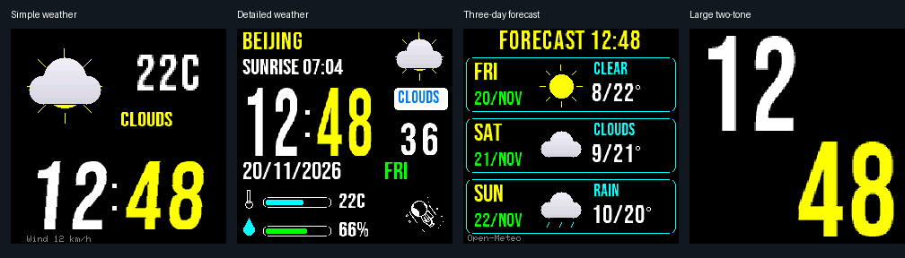
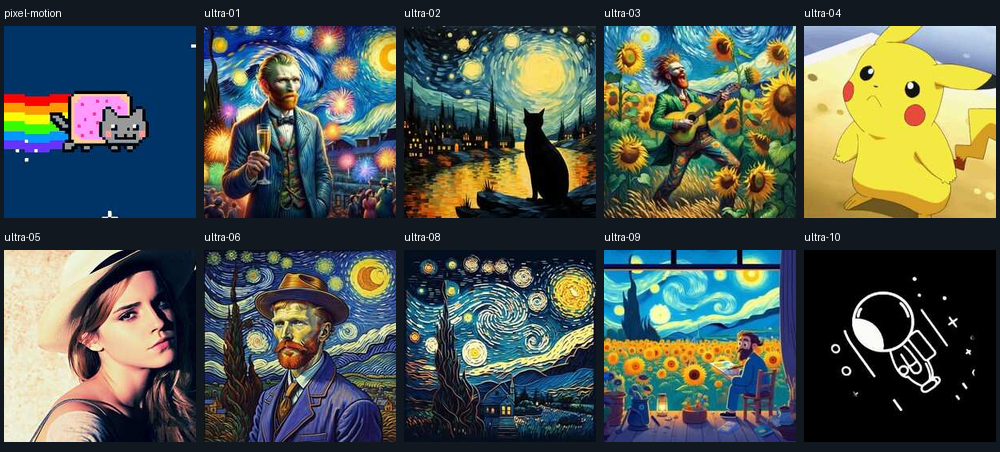

# NMMiner SmallTV Pro - User Manual

English edition | Firmware 3.13.1 | 2026-11-23 | Revision 3

This guide covers the project's capabilities. The main walkthrough uses NM-TV-154. Features shown in your browser depend on the firmware variant; a missing tab usually means that capability is not included. The browser is the remote control. The device screen presents information; it is not a touchscreen menu.

## 1. Start in five steps

1. Power the device through USB-C with a stable 5 V supply. Use a data-capable cable only when USB flashing a board with a USB-to-serial bridge.
2. Connect it to a 2.4 GHz WiFi network using the procedure in chapter 2.
3. Open its local web address. In Weather, search for your city and select the correct result. Check the timezone in Display. Press Save settings.
4. In General, select Weather, Stock 1 or Pictures as the display mode. Press Save settings. NM-TV-154's factory default is Detailed weather; an explicitly saved mode survives reboot.
5. After confirming one app works, add optional apps to Carousel or create a Timer schedule. Export a settings backup before making major changes.

Success looks like this: Status reports a station connection, the configured local time is correct, and the selected screen shows your own location or data. `Set location in Weather` is a setup instruction, not a network failure. The Large two-tone clock can be used without a weather location.

NM-TV-154 defaults to Chengdu, China (30.5728°N, 104.0668°E), with the Asia/Shanghai timezone (UTC+8, no daylight saving). Select and save your own city when using it elsewhere. Firmware updates retain saved locations and timezones; a factory reset restores the Chengdu defaults.

You do not need a phone app or a firmware cloud account. Weather and public market sources require internet access. Pictures work from local storage. Usage, Home Assistant and VPN have additional prerequisites described later.

## 2. Connect WiFi and find the web page

### First connection

Wait for the startup screens. If no saved network can be joined, the device creates a setup hotspot. Join the SSID shown on its screen, normally SmallTV-Setup, and open http://192.168.4.1 in a browser. Keep the connection when your phone warns that this network has no internet access.

NM-TV-154's factory hotspot password is `12345678`. Other variants normally use an open hotspot. Always use what the screen shows if the installer changed these defaults. The NM-TV-154 production configuration also contains an NMTech-2.4G network preset; failure to find that network falls back to setup mode. You do not need to create that network.

Open WiFi, press Scan networks, select your home network and enter its password. Press Save & connect (reboots). Rejoin your home WiFi after the setup hotspot disappears. The connected screen shows the device's new IP address and hostname.

### Returning later

Use `http://<device-ip>/` or `http://<hostname>.local/` from the same local network. Each device normally has a hostname such as smalltv-ab12. Your router's client list can show the current IP. Detailed weather also alternates the IP address with sunrise information every ten seconds.

Up to four networks can be saved. Visible networks are tried strongest first at boot; hidden or unavailable entries are also attempted. Removing a network row removes that saved network when you save. A blank password keeps the stored password for the same SSID; it does not erase it.

WiFi has a separate setup-hotspot password. The hotspot password and the web administrator password are different settings. Configure the fallback hotspot before moving the device to a different network. Guest-network isolation can prevent your phone from reaching the device even when both have internet access.

## 3. Understand navigation and saving

| Tab | Use it for |
| --- | --- |
| Status | Network mode, IP, firmware variant, runtime and diagnostics |
| General | Display mode, Carousel, Timer and screen refresh |
| Stock 1 / Stock 2 / Crypto | Market lists, charts and data intervals |
| Weather | City, weather units and four clock layouts |
| Display | Brightness, rotation, timezone, night/sun schedules, touch and theme clocks |
| Pictures | Full-screen pictures and animation packages |
| Plane Radar / Usage | Radar center and aircraft feed / computer-supplied usage data |
| WiFi | Networks, device name, fallback hotspot and optional WireGuard |
| System | Firmware update, backup, password and maintenance |

The language selector changes the browser UI between Chinese and English. Screen language and available glyphs are separate. NM-TV-154 uses a compact ASCII screen font; Chinese and other unsupported characters may appear as `?`. Use a short English location or notification label for predictable display.

### Which button does what?

| Action | What is saved or changed |
| --- | --- |
| Save settings | Saves pending settings across all tabs; normally applies immediately |
| Save & connect | Saves the WiFi list and restarts the device |
| A weather layout shortcut | Saves settings, switches to Weather and fixes that layout by turning layout rotation off |
| Use theme | Saves that installed theme and switches to Theme clock |
| Show picture | Saves the selected picture and picture rotation settings, then switches to Pictures |
| Save radar settings | Saves radar settings without choosing Radar as the display mode |
| Save and show radar | Saves radar settings and switches to Radar |
| Install / Remove package | Changes the device's package files immediately |

Save settings is a global action. Finish or discard edits in other tabs before using it. Editing a field, selecting a city, changing a dropdown or navigating to a tab does not by itself save settings. A tab is an editor, not an instruction to display that app. Network identity changes can trigger a reboot; wait for the success or reboot message.

### Search and select data

Cities, timezones, stocks and Spot pairs combine common entries, input search and manual entry. Type at least two characters and pause for about 0.35 seconds for online lookup. Chinese input waits for composition to finish. Choosing a result only edits the form: press Save settings to apply it. Searching never applies the first result automatically.

Cities: Weather, Display and Plane Radar share the search. Common cities and your last eight selected cities work offline; the browser searches Open-Meteo for more. Check the region, coordinates and timezone to distinguish cities with the same name. Selecting an independent radar center leaves the weather location unchanged.

Timezones: filter Display's list by city, country, Chinese/English aliases or an IANA ID such as Asia/Shanghai. The selected timezone remains available while filtering. A supported city selects a device timezone rule including daylight saving. An unsupported city shows a warning and preserves the current timezone. Existing custom rules survive; the current UTC offset never substitutes for a daylight-saving rule.

Stocks: enter a company name, common Chinese alias or symbol in Stock 1 or Stock 2. Results identify the market and Yahoo/Naver source. Selection fills an empty row; selecting an existing source/symbol does not duplicate it. Common entries work offline. ESP32 ticker builds can query more Yahoo equities and ETFs through the device; other boards retain manual entry. Naver name search is unavailable: use its curated entries or enter its symbols manually. Symbols are provider-specific. A successful lookup does not guarantee that the quote provider is reachable.

Crypto: search Bitcoin, BTC, BTC/USDT or a complete symbol. The browser downloads Binance's active Spot directory on its first online lookup, which may take several seconds. The compact directory is cached for up to 24 hours. If unavailable, common pairs remain labeled as presets; verify their trading status. Futures and delisted entries are excluded from a successful directory lookup. Clearing browser site data removes recent cities and the directory cache, leaving saved device settings intact.

Loading, no matches and online search unavailable are distinct states. Continue with local entries or manual input after a network failure. Stock lookup needs the device's internet connection; city and pair lookup need the browser's connection.

## 4. Choose what appears on screen

### One app

In General, choose an app directly and save. Its own internal pages may still rotate: Stock 1 can cycle symbols, Pictures can cycle images, and Weather can cycle layouts. Disable that app's internal rotation where available if you want one item to remain visible.

### Carousel - rotate apps

Choose Carousel, tick the apps you want, set Switch mode every (minutes), and save. The valid dwell range is 5 seconds to 60 minutes; enter 0.5 for 30 seconds. Only checked apps appear. Fresh configurations initially include Stock 1 and Weather; optional integrations are opt-in. Existing saved checkboxes are preserved on upgrade.

The order follows the app list. Touch Next page advances within the checked apps and restarts the dwell. Home returns to the first checked app. Neither action disables Carousel. An empty selection is rejected by the web page; an empty configuration imported through the API shows a setup message.

### Timer - change apps at local times

Choose Timer, enable at least one of the four rows, choose a 24-hour time and an app, then save. Each entry starts that app and keeps it active until the next enabled entry. It is a daily schedule; there are no weekday rules.

For example, 06:00 Weather, 09:00 Stock 1 and 20:00 Pictures means Pictures remains active after midnight until 06:00. The most recent enabled time applies, including a time from the previous day. Avoid duplicate times. Invalid or unavailable entries are ignored. Without synchronized time the screen waits for the clock; with no usable entry it requests configuration.

Set the timezone in Display first. A touch Next page previews another app for 15 seconds, then Timer resumes. Home resumes the schedule immediately. Touch previews do not rewrite the saved mode.

### Three independent rotations

| Rotation | Changes | Example |
| --- | --- | --- |
| General Carousel | App | Weather to Pictures every 30 seconds |
| App rotation | Content within an app | AAPL to NVDA; image 1 to image 2 |
| Weather layout rotation | Clock layout within Weather | Detailed to Forecast every 20 seconds |

A short app dwell may end before its internal cycle completes. Start with one rotation level, then combine them after you can predict the result.

## 5. Use the touch control and temporary screens

NM-TV-154 has one capacitive touch area on top. Default short touch is Next page. Holding for about 0.6 seconds triggers Home. Other boards can have different defaults or no touch control. Check Display for the actions actually configured on your unit.

In a single-app mode, Next page previews the next compiled app; Home returns to the saved app. In Pictures it changes apps, not images. Picture changes are controlled by the Pictures selector and its internal rotation.

Available assignments include no action, a brief screen-off blink, Home, Next page, network/IP information, temporary wake and notification acknowledgement. Sensitivity is a percentage of the idle touch reading. Start at the default; lower values require a firmer touch, higher values are more sensitive.

Setup screens, network information, notifications and screen-refresh effects temporarily cover the normal app. A touch dismisses a refresh. Notifications expire or can be acknowledged using the assigned action. The configured app or automatic mode then continues.

## 6. Set up weather and clock layouts

Search for a city in Weather, choose the correct country/region, and check its coordinates. Supported city timezones are selected automatically; verify the timezone under Display, especially after entering coordinates manually. The Weather and Display location fields describe the same device location and stay synchronized. 0/0 means unset; a single zero coordinate is valid.

Enter an optional English location label, choose Celsius or Fahrenheit and km/h, m/s or mph, then save. A missing weather location shows `Set location in Weather`. The device does not silently query another city. Clock timezone and weather-location dates should agree if you want matching local-day information.

| Layout | What you see |
| --- | --- |
| Simple weather clock | Time with essential weather information |
| Detailed weather clock | Seconds, weather details, animated spaceman, sunrise/IP alternating line |
| Three-day forecast | Daily conditions and high/low temperatures for three days |
| Large two-tone clock | Large time layout; also works without a weather location |

Use a layout shortcut for a fixed layout. To cycle layouts, enable Auto-rotate clock layouts, set 10-3600 seconds and save. Changing layouts does not require reinstalling picture packages; the spaceman in Detailed weather is embedded in the firmware.

The default weather refresh interval is ten minutes. After a failed refresh, a successful previous reading remains cached and the device retries. Data is cached in RAM, so a reboot needs a new fetch. City search runs in your browser; forecast requests run on the device. One may work while the other is blocked.

Open-Meteo requires no key for its free non-commercial service. Commercial distribution or deployment must use the appropriate service terms or plan. This firmware does not include a commercial weather subscription.



## 7. Display stocks and crypto

Stock 1 starts with Samsung Electronics (`005930`, Naver), NVIDIA (`NVDA`, Yahoo Finance) and Apple (`AAPL`, Yahoo Finance). The default is a one-month line chart with 20 points, a ten-second symbol dwell and a 120-second refresh. No API key or proxy is required for these defaults.

Choose Stock 1 in General to display it. Edit the symbol rows in its tab, or use a market preset. Select the source that understands the symbol: Naver uses `005930`; Yahoo's Korean market listing is `005930.KS`. Stock 2 is an independent list and starts empty. Add symbols before displaying it or including it in Carousel.

Each stock list supports up to eight entries, a line/candlestick chart, chart timeframe, point count, refresh interval, rotation interval and visible fields. The change basis can follow the chart timeframe or compare with the previous daily close. A one-month chart and daily change can therefore describe different periods if you select that combination.

Optional quantity and cost fields enable position P/L and a portfolio page. Totals remain separated by currency; the device does not perform currency conversion. To remove an entry, remove its row and save. An intentionally empty list remains empty.

Crypto uses Binance Spot pairs such as `BTCUSDT`, `ETHUSDT` and `SOLUSDT`. These are independent from Yahoo symbols such as `BTC-USD`. Its list, refresh and rotation settings are separate. Binance service availability depends on network and region.

`loading` means data is pending. `fetch error` or a red stale-data indicator means the last attempt failed; the device retries automatically. Public data may be delayed, limited, unavailable outside market hours or rate-limited. A fresh screen redraw does not mean a fresh market quote. Advanced cash.ch, GitHub and webhook sources require their own compatible symbol or service setup.

## 8. Use Pictures and Theme clocks

### Pictures / Photo Album

Open Pictures, select an installed package and press Show picture. Turn off Auto-rotate pictures first to keep that image selected. Otherwise choose an interval from 2 to 3600 seconds. Add Pictures to Carousel only if you want the album to share time with other apps.

NM-TV-154's factory library contains ten 240x240 RGB JPEG picture/animation packages. The three factory animations have two sampled frames to fit local storage. The Detailed weather spaceman is a separate 14-frame firmware asset. Its black-and-white artwork is intentional.

Refresh pictures reloads the package list. Install .stheme adds a compatible package; custom picture IDs must start with `picture-`. Direct JPG, PNG or GIF upload is not supported. Convert photos on a computer with the theme tools, or obtain a compatible package from the supplier.

Pictures and clock themes share available storage and a 16-package limit. Keep source packages on your computer. To replace a package, first switch to another mode and untick its slot in Carousel, save, remove the inactive old package and install the replacement. Never remove a package you still need without a copy.

### Theme clocks

Under Display, install or choose a theme and press Use theme. Classic 12 and Classic 24 are included in NM-TV-154 factory images. Set the timezone; time fields remain unavailable until NTP synchronizes. Theme clock is a separate app from the four built-in Weather layouts.

A theme can contain its own images, animations and fetched data. Custom themes need compatible manifests and may need network services. Selecting the Theme clock mode alone does not choose a package; select one in Display first.

### Update an older album

App-only OTA preserves existing files and cannot replace an old low-color or invalid picture library. A `layers[0].loop` warning means the animation package is incompatible. Install the supplied v2 full-color library as well as the firmware.

With the supplied library ZIP extracted, run `python update_nm_tv_154_pictures.py <device-ip>` to preview, then run it again with `--apply`. The tool validates checksums, replaces the ten built-ins and restores the saved mode/selection. Keep its state file and repeat the command after an interruption. It preserves custom packages; it cannot fit a library when custom files leave insufficient space.



## 9. Set the Plane Radar center

Open Plane Radar. Choose Use weather/device location for your own position, or disable it and choose a separate radar center. Presets work offline; city search requires internet access in the browser. Coordinates use decimal degrees: north/east positive, south/west negative. 0/0 means unset.

Set a search radius, refresh interval and aircraft source. adsb.lol and adsb.fi are built-in public feeds; a LAN webhook requires a compatible proxy. Radius uses kilometers; the distance-unit setting changes display units. Minimum altitude is in feet. Labels, heading vectors, edge markers and optional airport markers can be configured separately.

Press Save radar settings to keep the configuration, or Save and show radar to display it immediately. The center marker is the radar's observation center, not an aircraft selection. This firmware does not include the separate ESP32-Plane-Radar project's complete flight-detail browsing interaction.

An empty scope can mean no traffic, an altitude/range filter or a failed source request. Read the Radar diagnostic line in Status before moving the center. `all filtered out` and an HTTP/TLS error are different outcomes. Coverage and refresh depend on the provider and local ADS-B reception.

## 10. Connect optional integrations

### Usage meter

Usage needs a compatible clawdmeter-daemon on the computer that supplies usage data. In push mode, leave the device's daemon URL blank and run the daemon with `--push-to <device-ip-or-hostname>`. In pull mode, run its HTTP server and enter `http://<pc-ip>:8787/` in the Usage settings. Allow the required local network connection through the computer's firewall.

Choose Usage in General or add it to Carousel after the daemon works. `waiting` or `daemon error` can mean the computer is asleep or the sender is absent. The device does not retrieve account usage independently. The hide-5-hour-card option changes the layout; it does not change your service limits.

### Home Assistant

The device receives screen definitions from Home Assistant through an MQTT broker. Test a fixed screen before adding sensor automations:

1. On Home Assistant OS, install and start Mosquitto broker from the apps/add-ons store. Other installations can use an existing LAN broker. Add or configure MQTT under Settings → Devices & services so HA connects to that broker.
2. Prepare a username and password accepted by the broker. In the device's Display → MQTT/Home Assistant card, enter the broker's LAN IP, port `1883` and MQTT credentials, then Save settings. Enter only a host or IP: omit `http://`, HA's web port `8123` and `/api` paths. MQTT credentials are separate from the device web password and HA access tokens.
3. After filling in an initially empty broker host, use System → Reboot. Clearing the host to disable MQTT also requires a reboot; Status explains this. Changing an existing broker's connection settings normally applies immediately.
4. Read Hostname on the device's WiFi tab. In HA, open Developer tools → Actions, switch to YAML, replace `YOUR_HOSTNAME` below with that exact hostname and run the action.

```yaml
action: mqtt.publish
data:
  topic: smalltv/YOUR_HOSTNAME/screen/hello
  retain: true
  payload: '{"bg":"#003366","ttl":0,"draw":[{"t":"text","x":120,"y":100,"s":2,"c":"#FFFFFF","a":"c","v":"Hello HA"}]}'
```

5. Select Home Assistant in the device's General tab and save. The screen should show `Hello HA`. Connecting the broker alone does not create a dashboard. Home Assistant and Claude Usage are excluded from the default Carousel; explicitly select Home Assistant to include it later.
6. Use the HA feature reference and `blueprints/automation/smalltv/` to create sensor automations. Publish compatible retained JSON to `smalltv/<hostname>/screen/<slot>`. Slots such as `energy` and `temperature` are separate screens, rotating with the MQTT card's dwell setting. Keep the hostname and topics consistent.

Listen to `smalltv/<hostname>/availability` in HA's MQTT integration: `online` confirms that the device connected to the broker. If absent, check the address, port, credentials and LAN access. If online but blank, check the topic, JSON and selected display mode. HA discovery primarily provides a brightness entity; it does not automatically turn every HA sensor into a device screen. NM-TV-154 uses an ASCII screen font, so test with English labels first.

Brightness state is published on `smalltv/<hostname>/brightness`. Publish a plain integer such as `70`, without retain, to `smalltv/<hostname>/brightness/set` to change it. The broker connection uses local plain TCP; configure your network accordingly. Clear HA screens removes stored screens and, when connected, their retained broker copies.

### WireGuard

WireGuard is available only in supporting firmware builds. It is optional for local operation and does not improve weather or market source availability by itself. Configure the private key, peer public key, endpoint host/port, tunnel address with prefix, Allowed IPs and keepalive using values from your VPN administrator.

This firmware accepts one IPv4 destination CIDR in Allowed IPs, for example `10.6.0.0/24`; it is not a full desktop WireGuard configuration importer. Give the server a peer route to this device. A synchronized clock is needed. Read the WiFi tunnel-status line for unresolved names, bad configuration, held state or handshake information.

Keep the web page on your LAN or a VPN. Avoid exposing its plain HTTP service directly to the internet.

## 11. Adjust the display and temporary overlays

Display controls brightness and rotation. Begin with default color order, inversion and 100% RGB gains. If the entire UI swaps red and blue, test RGB/BGR. If only old photos have reduced colors, update their picture packages instead. Reset gains before judging image color.

Night mode dims the panel within a local-time window, including windows that cross midnight. Zero percent blanks the backlight, not the device. It resumes after clock synchronization. A temporary wake action can reveal the screen. Sunrise/sunset brightness needs the shared device location and clock; check the selected overlap rule when enabling it together with night mode. Light-sensor auto-brightness is available only on boards with a populated sensor.

General's Screen Refresh runs a temporary Matrix, Rainbow, Starfield, Black, White, Snow or Mascot effect at an interval or daily time. This is separate from app rotation. Touch returns to the app. It exercises pixels; it is not a guarantee against all LCD image retention.

Notifications are pushed by scripts to `/api/notify`. They temporarily cover the current screen and then return to it. The queue prioritizes urgent messages. A local test from a terminal is:

```sh
curl -X POST http://<device-ip>/api/notify \
  -H "Content-Type: application/json" \
  -d '{"type":"info","title":"HELLO","label":"Device ready","ttl":5}'
```

If web authentication is enabled, use a client supporting HTTP Digest authentication for protected APIs. Use ASCII labels on NM-TV-154. Multi-line wrapped cards and animation parameters are documented in the Notifications feature reference.

## 12. Back up, update and recover

### Back up before changes

Open System and Export settings. The JSON includes WiFi passwords and VPN secrets, so store it privately. Export does not include picture/theme files or restore the separate HA screen store. Keep those source packages separately. Import applies the JSON and reboots.

### Choose the right update file

| File / action | When to use it | Effect |
| --- | --- | --- |
| App OTA `.bin` | Routine update on a compatible partition layout | Preserves settings and package files; reboots |
| Full-color library ZIP + updater | Replace old built-in pictures | Changes picture files; preserves custom files/settings when successful |
| Factory `.bin` over USB/UART | First installation, partition migration or recovery | Includes partitions and files; can overwrite stored settings/files |
| Factory reset in System | Start configuration again | Removes saved settings; existing theme/picture files remain |

In System, Manual update (OTA), choose the matching app file and press Upload & flash. Keep power connected and wait for reboot before reloading. Never upload a factory image through the web OTA form. Standard NM-TV-154 and WireGuard NM-TV-154 share the current layout, but choose the build matching your intended feature set.

GitHub update uses the release repository and firmware variant configured in your installed build. Locally supplied improvements may not yet be published there. A manual local update does not publish a GitHub release. Check the release notes and target filename before choosing a remote release.

### Password and recovery

The default web username is `admin`. There is no default web password, so first access needs no login. NM-TV-154's `SmallTV-Setup` WiFi hotspot defaults to `12345678`; this is configured separately from the web password. Updates retain any passwords you have changed.

The administrator password protects the page and most APIs with HTTP Digest authentication. Enter it twice, remember the username and save. Leaving both fields blank keeps the saved password. Remove password is an explicit action. The usage push endpoint remains available for the compatible sender.

There is no administrator-password recovery page. Recovery may require the correct factory image through USB or the internal UART header. A routine app-only reflash preserves settings and therefore may preserve the forgotten password. Identify the board before flashing; closing a serial monitor releases its port for flashing.

## 13. Diagnose common problems

| Symptom | First checks |
| --- | --- |
| No setup page | Stay on SmallTV-Setup; disable mobile-data switching temporarily; open http://192.168.4.1 manually |
| Cannot reach a connected device | Same LAN, current IP/router list, guest isolation, hostname spelling |
| Wrong weather city or `Set location` | Select your actual city, save, check shared coordinates and Display timezone |
| Wrong clock or Timer waiting | Internet/NTP access, timezone, optional NTP server; allow synchronization after reboot |
| Unexpected Carousel pages | Check all visible app checkboxes; distinguish app dwell from picture/symbol/layout rotation |
| Touch leaves the album | Next page switches apps; Home returns to the saved mode; configure actions in Display |
| Black screen but web page works | Brightness, night/sun schedule, rotation, temporary wake and panel settings |
| Picture loop warning / low colors | Install the v2 picture library; OTA alone leaves old files |
| Package upload fails | Duplicate ID, active package, 16-package limit or insufficient free storage |
| Stock error / unchanged price | Correct source/symbol, market hours, internet, rate limit and stale indicator |
| Empty radar | Center, source, range/altitude filters and Status Radar diagnostics |
| Usage / HA shows no data | Running daemon or MQTT publisher, correct addresses/topics and required restart |
| Display remains in CRASH safe mode | Apps are paused. Record Last reset / Last crash, then try System → Reboot; if repeated, capture serial output and install a matching fix |

The serial console on NM-TV-154 normally uses 115200 baud. `COM3` is one Windows port example, not a fixed device setting. An existing `No core dump partition found` startup warning does not by itself indicate a crash; inspect the reset reason and whether startup completes. Do not erase or factory reset as the first step for a source outage.

From 3.13.1, NM-TV-154 retains the panic reason, available program address (PC), up to 12 backtrace addresses, last operation and approximate uptime in RTC memory, shown as Last crash. A normal reboot retains it; Clear or complete power loss removes it. This is not a full backtrace and cannot recover details lost by older firmware. Keep the matching debug ELF and serial Backtrace for investigation.

## 14. Hardware differences and support checklist

| Variant | What to expect |
| --- | --- |
| NM-TV-154 `smalltv_esp32_wg` | 4 MB, full app set, Pictures, touch, WireGuard, compact ASCII font |
| NM-TV-154 `smalltv_esp32` | Same app set and storage layout, without WireGuard |
| SmallTV Pro `smalltv_esp32_8mb` | 8 MB; current target enables WireGuard and Korean font; Usage/Radar/HA and Pictures are not included in this target |
| ESP32-C2 `smalltv_c2` | Different board/partition layout; WireGuard available; use only a matching image |
| ESP8266 `smalltv` / `smalltv_lean` | No WireGuard; tighter memory; lean removes Usage, HA and Theme clocks |

Features absent from the build are hidden in the UI. Do not choose a binary solely because the enclosure looks similar. For NM-TV-154's current layout the two OTA slots are 1,966,080 bytes and the picture/settings filesystem is 192 KiB. First migration from an older layout requires the matching factory image.

For support, record the board, firmware version and variant, reset reason, current mode, relevant non-secret settings, source error and reproduction steps. Keep an export privately for recovery; do not post passwords or VPN keys with a bug report. Confirm the physical panel's colors and touch operation after firmware or hardware changes.
