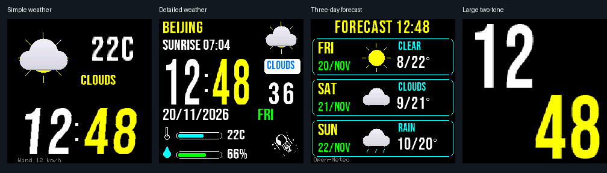
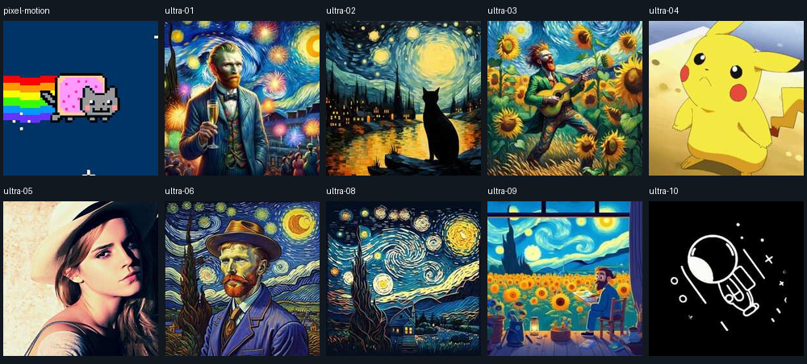

# NMMiner SmallTV Pro 使用手册

中文版 | 固件 3.13.1 | 2026-11-23 | 第 3 版

本手册覆盖项目提供的功能，主要以 NM-TV-154 演示操作。实际可用功能由所安装的固件决定；没有某个页签，通常表示该固件未包含此功能。浏览器是设置入口，设备屏幕用于展示信息，不是可点击的触摸菜单。

## 1. 五步开始使用

1. 使用稳定的 5 V USB 电源为设备供电。只有通过带 USB 转串口芯片的接口刷机时，才必须使用支持数据传输的线缆。
2. 按第 2 章连接 2.4 GHz WiFi。
3. 打开设备网页，在 Weather（天气）搜索并选择城市，在 Display（显示）核对时区，点击 Save settings（保存设置）。
4. 在 General（常规）选择 Weather、Stock 1 或 Pictures 等显示模式，再保存。NM-TV-154 出厂默认是详细天气；明确保存的模式会在重启后保留。
5. 单个应用正常后，再配置 Carousel（轮播）或 Timer（定时）。较大调整前导出设置备份。

完成的判断标准：状态页显示已连接家庭网络，时间正确，设备显示自己设置的城市或数据。`Set location in Weather` 表示需要设置地点，不代表联网失败。不需要天气时，可直接使用不依赖位置的大号双色时钟。

NM-TV-154 的出厂地点默认为中国成都（30.5728°N，104.0668°E），时区为 Asia/Shanghai（UTC+8，无夏令时）。在其他城市使用时，请选择自己的城市并保存。固件升级保留已保存的位置和时区；恢复出厂设置后使用成都默认值。

基础使用不需要安装手机 App，也不需要固件云账号。天气和公共行情需要互联网；图片读取本地文件。用量、Home Assistant 和 VPN 有各自的前置条件，不能仅勾选模式就自动获得数据。

## 2. 连接 WiFi 与找回设置网页

### 首次连接

等待启动过程结束。如果无法连接已保存的网络，设备会开启设置热点。连接屏幕显示的热点，通常为 SmallTV-Setup，然后打开 http://192.168.4.1。手机提示“无互联网”时，请选择继续使用此网络。

NM-TV-154 出厂热点密码为 `12345678`；其他版本通常是开放热点。如果供应商修改过，请以设备屏幕显示为准。NM-TV-154 的生产配置还预置了 NMTech-2.4G 网络；找不到该网络时会进入设置热点，无需为此另建一个同名网络。

打开 WiFi 页签，点击 Scan networks（扫描网络），选择自己的网络并填写密码，然后点击 Save & connect (reboots)（保存并连接，设备将重启）。热点消失后，让手机重新连接家庭 WiFi。设备的连接提示屏会显示新的 IP 和主机名。

### 以后如何打开

在同一局域网中访问 `http://<设备IP>/` 或 `http://<主机名>.local/`。默认主机名通常带设备后缀，例如 smalltv-ab12。也可以在路由器的在线设备列表查询 IP。详细天气的日出信息行每十秒会轮换显示设备 IP。

最多保存四个网络。开机时优先尝试扫描到且信号较强的网络，也会尝试隐藏或暂时不可见的网络。删除某行并保存，会移除该网络。同一 SSID 的密码留空表示保留原密码，不表示清空。

设置热点的 WiFi 密码与网页管理员密码是两回事。搬到新网络前，可先配置可用的备用热点。访客 WiFi 的客户端隔离可能导致手机与设备都能上网，却不能互相访问。

## 3. 理解页签与保存操作

| 页签 | 主要用途 |
| --- | --- |
| Status／状态 | 网络模式、IP、固件版本、运行和诊断信息 |
| General／常规 | 显示模式、应用轮播、每日定时、屏幕刷新 |
| Stock 1／Stock 2／Crypto | 两组股票和加密货币、曲线与刷新周期 |
| Weather／天气 | 城市、天气单位、四种时钟布局 |
| Display／显示 | 亮度、旋转、时区、夜间／日出日落、按键、主题时钟 |
| Pictures／图片 | 全屏图片和动画包 |
| Plane Radar／Usage | 雷达中心与飞机来源／电脑提供的用量数据 |
| WiFi | 已保存网络、主机名、设置热点、可选 WireGuard |
| System／系统 | 固件升级、备份、管理员密码、重启和重置 |

网页语言选择器支持中文和英文。网页语言与设备字体独立：NM-TV-154 使用精简 ASCII 屏幕字库，中文等不支持的字符可能显示为 `?`。设备地点名和通知内容建议使用简短英文。

### 不同按钮的区别

| 按钮 | 保存或改变的内容 |
| --- | --- |
| Save settings／保存设置 | 保存所有页签中尚未保存的设置，通常立即生效 |
| Save & connect／保存并连接 | 保存 WiFi 列表并重启 |
| 天气布局快捷按钮 | 保存设置、切换到天气，并关闭布局自动轮播，固定所选布局 |
| Use theme／使用主题 | 保存选定的已安装主题，并切换到主题时钟 |
| Show picture／显示图片 | 保存图片选择及图片轮播设置，并切换到图片模式 |
| Save radar settings／保存雷达设置 | 保存雷达配置，不改变当前显示模式 |
| Save and show radar／保存并显示雷达 | 保存雷达配置，并切换到雷达 |
| Install／Remove package | 立即安装或删除设备上的资源文件 |

“保存设置”是全局操作。其他页签中的草稿也会一起保存，因此使用前请完成或放弃这些修改。编辑输入框、选城市、改下拉选项、打开页签，都不等于已经保存；打开某个设置页也不等于切换到该应用。网络身份变化可能触发重启，请观察成功提示。

### 输入检索与选择

城市、时区、股票和交易对使用“常用数据 + 输入检索 + 手工输入”的方式。输入至少两个字符，停止输入约 0.35 秒后开始在线检索；中文输入法完成组词后才查询。选择结果只修改表单，仍需点击保存设置。仅搜索不会自动应用第一条结果。

城市：Weather、Display 与 Plane Radar 共用检索。常用城市和最近八个已选城市可离线使用；更多城市由浏览器查询 Open-Meteo。结果带地区、坐标和时区，请确认同名城市。雷达独立中心不会改动天气位置。

时区：在 Display 输入中文城市、国家、英文名称或 IANA 标识（如 Asia/Shanghai）过滤列表。已选时区始终保留。支持的城市会联动设备时区及夏令时规则；不支持时会提示确认，并保留原时区。已有的自定义时区规则也会保留，不会用当前 UTC 偏移替代夏令时规则。

股票：在 Stock 1 或 Stock 2 输入公司名、中文别名或代码，如苹果、英伟达、三星。结果明确标注市场和 Yahoo／Naver 来源；选中后填入空行，已有相同来源与代码的条目不会重复添加。常用条目离线可用；ESP32 股票固件可经设备查询 Yahoo 的更多股票及 ETF，其他型号可手动输入。Naver 的在线名称检索目前不可用，使用常用条目或手工填写其代码。不同来源的代码不能混用；搜索成功也不保证行情接口可用。

加密货币：输入比特币、BTC、BTC/USDT 或完整代码。浏览器首次在线查询 Binance 可交易现货目录，可能需要数秒；精简目录缓存最长 24 小时。未能查询目录时仍可选择带“预设”标记的常用交易对，需自行确认可交易。不会把期货或已下架条目当作当前现货目录结果。清理浏览器站点数据会删除最近城市和目录缓存，不会删除设备上已保存的配置。

“正在检索”“没有匹配结果”和“在线检索暂不可用”含义不同。联网失败时继续使用本地条目或手动输入；无需反复保存。股票在线搜索依赖设备联网，城市和交易对在线搜索依赖浏览器联网。

## 4. 决定设备显示什么

### 单应用模式

在 General 直接选择某个应用并保存。该应用内部仍可能轮换内容，例如 Stock 1 轮换股票、Pictures 轮换图片、Weather 轮换布局。如果希望只看一个内容，还需关闭对应的内部轮播，或只保留一个条目。

### Carousel：按间隔轮播应用

选择 Carousel，勾选需要的应用，设置 Switch mode every (minutes) 后保存。范围为 5 秒至 60 分钟；填写 0.5 表示停留 30 秒。只显示勾选的应用，顺序以应用列表为准。

新配置只预选 Stock 1 与 Weather；依赖外部服务的应用需要主动加入。升级会保留已有的明确勾选项。先配置好 Stock 2、用量、雷达、Home Assistant 或主题包，再加入轮播，可以避免空页面。

短按“下一屏”只在勾选项之间切换，并重新开始停留计时；“返回首页”回到第一个勾选项，两者都不会关闭轮播。网页不允许保存全部未勾选的轮播；通过 API 导入空列表时，设备显示设置提示。

### Timer：按本地时间切换应用

选择 Timer，在四个条目中至少启用一个，填写 24 小时制时间与应用，然后保存。每个条目表示从该时间起显示某应用，直到下一个启用条目。每天重复，不区分工作日和周末。

例如 06:00 天气、09:00 Stock 1、20:00 图片，则午夜后仍显示图片，直到次日 06:00。设备寻找最近已生效的条目，支持跨午夜。避免设置相同的时间；格式错误或本固件不支持的应用条目会被忽略。

先在 Display 设置时区。未同步时间时，设备等待时钟；没有可用计划时，显示设置提示。短按“下一屏”临时预览其他应用，15 秒后恢复定时计划；“返回首页”立即恢复计划。触摸预览不改变已保存的模式。

### 不要混淆三层轮播

| 轮播层级 | 切换什么 | 示例 |
| --- | --- | --- |
| General 的 Carousel | 不同应用 | 每 30 秒在天气与图片之间切换 |
| 应用内部轮播 | 同一应用的条目 | AAPL 切换到 NVDA、图片 1 切换到图片 2 |
| 天气布局轮播 | 天气中的时钟样式 | 每 20 秒从详细天气切换到三日预报 |

应用停留时间过短时，内部内容可能尚未轮完。建议先使用一层轮播，确认结果后再组合。

## 5. 触摸按键与临时页面

NM-TV-154 顶部有一个电容触摸区域。默认短按是“下一屏”，持续约 0.6 秒是“返回首页”。其他硬件可能默认动作不同，或者没有触摸输入；请以 Display 中的实际配置为准。

单应用模式下，“下一屏”临时浏览下一个已编译应用；“返回首页”回到已保存的应用。在 Pictures 内，“下一屏”切换的是应用，不是下一张图片。图片切换通过图片选择器及其自动轮播控制。

可分配动作包括无操作、短暂熄屏、返回首页、下一屏、显示网络/IP、临时唤醒、确认通知。灵敏度是相对空闲触摸读数的百分比。先保留默认值；数值越低越需要明确触摸，越高越灵敏。

配网页、网络信息、通知、屏幕刷新效果会临时覆盖日常页面。触摸可退出屏幕刷新；通知在到期或通过已分配的确认动作结束后退出，然后恢复配置的显示逻辑。

## 6. 天气与四种时钟布局

在 Weather 搜索并选择城市，核对国家、地区与坐标。搜索结果中的已支持时区会自动选中，但仍应在 Display 核对；手工填写坐标时尤其需要检查。Weather 与 Display 编辑的是同一个设备位置，两处坐标保持同步。

0/0 表示未设置地点；只有纬度为零或只有经度为零是合法位置。未设置地点时，天气布局提示 `Set location in Weather`，不会偷偷查询其他城市。大号双色时钟不依赖天气位置。

填写可选的英文地点名，选择摄氏或华氏、km/h、m/s 或 mph，再保存。设备时钟遵循 Display 的时区，天气日期来自所选地点；希望它们显示相同的本地日期时，应配置一致。

| 布局 | 主要内容 |
| --- | --- |
| Simple weather clock／简洁天气 | 时间与主要天气信息 |
| Detailed weather clock／详细天气 | 秒、天气详情、宇航员动画、日出／设备 IP 轮换行 |
| Three-day forecast／三日预报 | 三天天气与每日最高／最低温度 |
| Large two-tone clock／大号双色时钟 | 大字体时间，不设置天气地点也可使用 |

点击布局快捷按钮会固定该布局。需要轮换时，启用 Auto-rotate clock layouts，设置 10-3600 秒并保存。详细天气的宇航员内置在固件中，切换天气样式不需要重装图片包。

默认每十分钟刷新天气。刷新失败时保留内存中上次成功的数据，并自动重试；重启后需要重新获取。城市搜索由浏览器访问网络，天气请求由设备发出，两者的网络条件可能不同。

Open-Meteo 的免费服务用于非商业用途且无需 API Key；商业分发或部署应采用符合其条款的服务方案。本固件不附带商业天气订阅。



## 7. 股票与加密货币

Stock 1 默认提供三星电子（`005930`，Naver）、英伟达（`NVDA`，Yahoo Finance）和苹果（`AAPL`，Yahoo Finance）。默认显示一个月的折线图、20 个点，每只股票停留十秒，每 120 秒刷新；这些默认来源不需要 API Key 或自建代理。

在 General 选择 Stock 1 才会显示这组行情。在其页签编辑股票，或使用市场预设。代码必须与来源匹配：Naver 的三星代码是 `005930`，Yahoo 的韩国上市代码是 `005930.KS`。Stock 2 是独立列表，初始为空，应先添加条目，再显示或加入轮播。

每组最多八个条目，可配置折线／蜡烛图、时间范围、点数、刷新间隔、切换间隔和显示字段。涨跌可按图表周期计算，也可按前一交易日收盘计算；因此“一个月图表”与“当日涨跌”可能表示不同的时间跨度。

填写持仓数量和单位成本后，可显示浮动盈亏及组合页。组合按币种分别汇总，不自动换汇。删除条目后保存即可移除；主动清空的列表会保持为空。

Crypto 使用 Binance 现货交易对，例如 `BTCUSDT`、`ETHUSDT`、`SOLUSDT`，与 Yahoo 的 `BTC-USD` 不同；它有独立的列表、刷新和切换设置。Binance 的可用性取决于地区和网络。

`loading` 表示等待数据；`fetch error` 或过期数据红点表示上次获取失败，设备会自动重试。公共数据可能有延迟、限流或休市期间不变。页面重新绘制不等于收到新报价。cash.ch、GitHub 和 webhook 等高级来源需要匹配的代码或外部服务。

## 8. 图片相册与主题时钟

### Pictures／Photo Album

在 Pictures 选择已安装的图片并点击 Show picture。若要固定显示一张，先关闭 Auto-rotate pictures；需要自动轮换时，设置 2-3600 秒。只有希望相册与其他应用交替时，才需要在 Carousel 勾选 Pictures。

NM-TV-154 出厂库包含十个 240x240 RGB JPEG 图片／动画包。受本地空间限制，三个动画各取两帧。详细天气中的宇航员是另一份内置 14 帧资源；其黑白画风属于原素材，不代表丢色。

Refresh pictures 刷新列表。Install .stheme 安装兼容资源；自定义图片包 ID 必须以 `picture-` 开头。当前不能直接上传 JPG、PNG 或 GIF；请先在电脑上使用主题工具转换，或向供应方获取兼容包。

图片与主题共享存储空间，总计最多十六个包，实际数量还取决于剩余空间。替换包前，切换到其他模式，并在 Carousel 取消相应槽位，保存后删除不用的旧包，再安装新包。请在电脑上保留源文件。

### Theme clocks／主题时钟

在 Display 安装或选择主题，点击 Use theme。NM-TV-154 出厂镜像包含 Classic 12 与 Classic 24。主题时钟与四种内置天气布局是不同应用。选择时区后等待 NTP，同步前时间字段可能显示占位符。

自定义主题可包含图像、动画、文字及网络数据，需使用兼容格式，也可能依赖外部服务。仅在 General 选择 Theme clock 并不会选择一个主题包，应先在 Display 选择主题。

### 升级旧图片库

只升级 OTA 程序不会替换已有图片文件。`layers[0].loop` 表示动画包不兼容；旧低色数图片库也需要单独更新。请同时使用新版固件与配套 v2 全彩图片库。

解压图片库 ZIP，在解压目录运行 `python update_nm_tv_154_pictures.py <设备IP>` 做预检，再加 `--apply` 实际更新。工具验证校验值、替换十个内置包，并恢复模式及选择；自定义图片保留。中断后保留状态文件，在同一目录重跑；自定义文件占用过多时，工具会要求先释放空间。



## 9. 设置 Plane Radar 中心

打开 Plane Radar。需要以设备位置观察时，选择 Use weather/device location；希望观察其他区域时关闭该选项，再选独立中心。预设城市不依赖网络；城市搜索需要浏览器联网。使用十进制度，北纬／东经为正，南纬／西经为负，0/0 表示未设置。

配置搜索半径、刷新间隔与来源。adsb.lol、adsb.fi 为内置公共来源；LAN webhook 需要兼容代理。搜索半径单位为公里，距离单位选项改变屏幕显示单位；最低高度单位始终是英尺。

标签、航向线、边缘飞机及机场标记可以分别配置。Save radar settings 只保存；Save and show radar 保存并立即显示。中心标记代表观察中心，不是选中了一架飞机。本固件未包含独立 ESP32-Plane-Radar 项目的完整航班详情浏览交互。

没有飞机可能是无覆盖、无流量、过滤条件或来源请求失败。先看 Status 的 Radar 诊断信息，再考虑修改位置；`all filtered out` 与 HTTP/TLS 错误含义不同。数据覆盖和更新速度取决于供应方及当地接收情况。

## 10. 配置可选集成

### Usage／用量显示

需要在提供数据的电脑上运行兼容的 clawdmeter-daemon。推送方式下，设备的 daemon URL 留空，电脑以 `--push-to <设备IP或主机名>` 指定目标；拉取方式下，电脑运行 HTTP 服务，并在设备填写 `http://<电脑IP>:8787/`。按实际连接方式放行电脑防火墙。

数据正常后，再在 General 选择 Usage 或加入轮播。`waiting`、`daemon error` 可能表示电脑休眠或发送程序未运行；设备不会独立查询账户用量。“隐藏五小时卡片”只改变布局，不改变账户额度。

### Home Assistant

设备通过 MQTT broker 接收 Home Assistant 推送的屏幕，不直接登录 Home Assistant。先测试一张固定屏幕，再接入传感器自动化：

1. 在 Home Assistant OS 的应用／附加组件商店安装并启动 Mosquitto broker；其他安装方式可使用局域网已有的 MQTT broker。在 Home Assistant 的“设置 → 设备与服务”添加或配置 MQTT 集成，让 HA 连接该 broker。
2. 准备 broker 允许登录的用户名和密码。设备网页 Display → MQTT／Home Assistant 中填写 broker 的局域网 IP、端口 `1883` 和 MQTT 凭据，然后 Save settings。地址栏只填写主机或 IP，不填写 `http://`、HA 网页的 `8123` 端口或 `/api` 路径。填写的是 MQTT 凭据，不是设备网页管理员密码或 HA 访问令牌。
3. 首次由空 broker 地址启用后，进入 System → Reboot。反向清空地址停用也需要重启；状态页会提示。仅更换已有 broker 的连接设置通常立即生效。
4. 在设备 WiFi 页查看 Hostname。在 HA“开发者工具 → 动作”切换到 YAML，执行下列示例；把 `YOUR_HOSTNAME` 替换为设备实际主机名。

```yaml
action: mqtt.publish
data:
  topic: smalltv/YOUR_HOSTNAME/screen/hello
  retain: true
  payload: '{"bg":"#003366","ttl":0,"draw":[{"t":"text","x":120,"y":100,"s":2,"c":"#FFFFFF","a":"c","v":"Hello HA"}]}'
```

5. 在设备 General 选择 Home Assistant，保存。屏幕应显示 `Hello HA`。连接 broker 本身不会生成仪表盘；默认轮播不包含 Home Assistant 或 Claude 用量。如需轮播，主动勾选 Home Assistant 后保存即可。
6. 测试成功后，参考 HA 功能文档和项目 `blueprints/automation/smalltv/` 创建传感器自动化，向 `smalltv/<主机名>/screen/<槽位>` 发布兼容的 retained JSON。不同槽位如 `energy`、`temperature` 对应不同屏幕，按 MQTT 卡片中的停留时间轮换。保持主机名与 topic 一致。

可在 HA MQTT 集成中监听 `smalltv/<主机名>/availability`；收到 `online` 表示设备已连接 broker。没有 `online` 时检查 IP、端口、凭据和网络；有 `online` 但没有画面时检查 topic、JSON、是否选择 Home Assistant 模式。HA 自动发现主要提供亮度实体，不会把所有 HA 传感器自动变成屏幕。NM-TV-154 使用 ASCII 屏幕字体，先用英文标签测试。

亮度状态发布在 `smalltv/<主机名>/brightness`。向 `smalltv/<主机名>/brightness/set` 发送不带 retain 的纯整数，例如 `70`，即可修改亮度，不要发送 JSON 对象。MQTT 使用局域网明文 TCP。Clear HA screens 会清除设备屏幕，并在 broker 已连接时清除已知槽位的保留消息。

### WireGuard

仅支持该功能的固件会显示设置。局域网日常使用不需要 VPN；启用它也不等于外部天气或行情一定更快、更可用。私钥、对端公钥、服务器与端口、带前缀的隧道地址、Allowed IPs、keepalive 应按 VPN 管理员提供的值填写。

Allowed IPs 支持一个 IPv4 目标 CIDR，例如 `10.6.0.0/24`，不是桌面版完整配置导入器。服务器也必须配置指向该设备的 peer 和路由。WireGuard 需要同步时间；在 WiFi 页查看地址解析、配置错误、暂停状态或握手信息。

设备网页应通过局域网或 VPN 访问，不应直接将其明文 HTTP 端口暴露到公网。

## 11. 显示、夜间与临时覆盖

Display 可以修改亮度和旋转。颜色建议先保留默认色序、反相与 100% RGB 增益。如果整个界面红蓝对调，再测试 RGB/BGR；如果只是旧照片色彩不足，先更新图片包，不要通过增益补偿资源问题。

夜间模式按本地时间工作，支持跨午夜；亮度为零只关闭背光，设备仍运行。重启后需等时间同步。可用临时唤醒动作查看屏幕。日出／日落调光依赖设备位置和时钟；与夜间模式一起用时，要核对两者的重叠规则。自动感光亮度只适用于实际安装了光敏传感器的硬件。

General 的 Screen Refresh 会按间隔或每天指定时间显示 Matrix、Rainbow、Starfield、Black、White、Snow、Mascot 等临时效果；它与应用轮播不同，触摸可返回。该功能用于像素活动，不保证消除所有液晶残影。

通知由脚本推送到 `/api/notify`，临时覆盖当前页面，到期后恢复；队列按优先级处理。例如在终端运行：

```sh
curl -X POST http://<设备IP>/api/notify \
  -H "Content-Type: application/json" \
  -d '{"type":"info","title":"HELLO","label":"Device ready","ttl":5}'
```

开启网页密码后，受保护接口需要支持 HTTP Digest 的客户端。NM-TV-154 通知建议使用 ASCII 内容。多行自动换行卡片、动画和优先级参数见通知功能参考。

## 12. 备份、升级与恢复

### 先备份

在 System 点击 Export settings。JSON 包含 WiFi 密码及 VPN 私钥，应妥善保存。备份不包含图片／主题文件，也不恢复独立的 HA 屏幕存储，应另行保留这些资源。Import 用完整备份恢复设置后重启。

### 不同更新方式

| 文件或操作 | 使用场景 | 对设备的影响 |
| --- | --- | --- |
| 应用 OTA `.bin` | 已有兼容分区上的日常升级 | 保留设置与资源文件，完成后重启 |
| 全彩图片 ZIP 与更新工具 | 替换旧内置图片 | 更新内置图片，成功后保留自定义资源和设置 |
| USB／UART factory `.bin` | 首装、分区迁移或救援 | 包含分区及文件，可能覆盖配置与资源 |
| System 的 Factory reset | 重新开始配置 | 删除已保存设置，现有主题／图片文件仍保留 |

网页升级请选择 System → Manual update (OTA)，选择匹配的应用文件并点击 Upload & flash。保持供电，等待重启后再刷新网页。不要把 factory 镜像上传到 OTA 表单。NM-TV-154 标准版与 WireGuard 版使用同一当前分区，但功能不同，应按目标需求选择。

GitHub 更新使用固件中指定的仓库与版本对应文件。本地新功能可能尚未发布到该仓库；手动升级本地包也不等于已发布 GitHub release。使用远程升级前应查看发布说明及文件名，避免回到缺少本地改进的旧版本。

### 管理密码与找回方式

网页默认用户名为 `admin`，默认不设密码，首次访问无需登录。NM-TV-154 配网热点 `SmallTV-Setup` 的默认 WiFi 密码为 `12345678`，与网页密码分别设置；升级会保留已修改的密码。

管理员密码通过 HTTP Digest 保护网页和多数 API。输入两次并保存，记住用户名。密码框留空表示保留现值，Remove password 才会明确移除；兼容用量发送端使用的推送接口仍开放。

没有网页密码找回功能。遗忘后可能需要使用正确 factory 镜像，经 USB 或内部 UART 重新安装。普通应用 OTA 会保留设置，因此不一定能清掉遗忘的密码。刷机前确认板型，并关闭串口监视器以释放端口。

## 13. 常见问题排查

| 现象 | 优先检查 |
| --- | --- |
| 热点连上但无配网页 | 保持连接 SmallTV-Setup，暂时关闭手机自动切换移动网络，手动打开 http://192.168.4.1 |
| 已联网但打不开设备 | 当前 IP、同一局域网、访客隔离、主机名拼写 |
| 天气地点错误／要求设置位置 | 选实际城市并保存，核对共享坐标及 Display 时区 |
| 时间错误／定时等待时钟 | NTP 网络、时区、自定义 NTP 服务器；重启后等待同步 |
| 轮播出现不期望页面 | 检查全部应用复选框，区分应用、股票／图片、天气布局的三层轮播 |
| 触摸后退出相册 | “下一屏”切换应用；“返回首页”恢复保存模式；可在 Display 改动作 |
| 网页可访问但屏幕黑 | 亮度、夜间／太阳调光、临时唤醒、旋转及面板配置 |
| 图片 loop 警告／色彩不足 | 同时更新 v2 图片库，仅 OTA 不会替换旧文件 |
| 资源安装失败 | ID 重复、正在使用、十六包上限或空间不足 |
| 行情报错／价格不变 | 来源与代码、交易时段、网络、限流和过期标志 |
| 雷达没有飞机 | 中心位置、来源、半径／高度过滤、状态页诊断 |
| 用量／HA 没数据 | daemon 或 MQTT 发布方、地址／主题、是否需要重启 |
| 崩溃后停在 CRASH 安全模式 | 显示应用已暂停，先记录状态页的 Last reset / Last crash，再尝试 System → Reboot；反复出现时记录串口并安装匹配修复 |

NM-TV-154 串口通常为 115200 baud。`COM3` 只是 Windows 端口示例，不是设备固定参数。启动出现 `No core dump partition found` 本身不等于崩溃，应结合重启原因及启动是否完成判断。数据源临时不可用时，不要首先恢复出厂或擦除设备。

从 3.13.1 起，NM-TV-154 会将 panic 原因、可用程序地址（PC）、最多 12 个回溯地址、上次执行阶段和近似运行时长保存在 RTC 内存，状态页显示为 Last crash。正常重启保留该记录，Clear 或完全断电可清除。它不是完整堆栈，也不能恢复旧版已经丢失的异常信息；排查时应同时保留对应版本的 debug ELF 和串口 Backtrace。

## 14. 硬件差异与支持信息

| 硬件／构建 | 主要差异 |
| --- | --- |
| NM-TV-154 `smalltv_esp32_wg` | 4 MB，全应用、图片、触摸、WireGuard，精简 ASCII 字体 |
| NM-TV-154 `smalltv_esp32` | 同样应用和分区，不含 WireGuard |
| SmallTV Pro `smalltv_esp32_8mb` | 8 MB，当前目标含 WireGuard 和韩文字体；未包含 Usage／Radar／HA／Pictures |
| ESP32-C2 `smalltv_c2` | 不同板型与分区，支持 WireGuard，应选专用镜像 |
| ESP8266 `smalltv`／`smalltv_lean` | 不含 WireGuard，内存较紧；lean 进一步移除 Usage、HA 和主题时钟 |

没有编译的功能会在网页隐藏。不能只凭外壳相同选择镜像。NM-TV-154 当前分区有两个 1,966,080 字节 OTA 槽和 192 KiB 文件系统；旧分区迁移必须使用匹配 factory 镜像。

反馈问题时，记录板型、固件版本与变体、重启原因、当前模式、相关非敏感配置、数据源错误和复现步骤。设置备份请私下保存，不要在问题报告中公开密码或密钥。固件或硬件变化后，应实际观察面板色彩与触摸响应。
